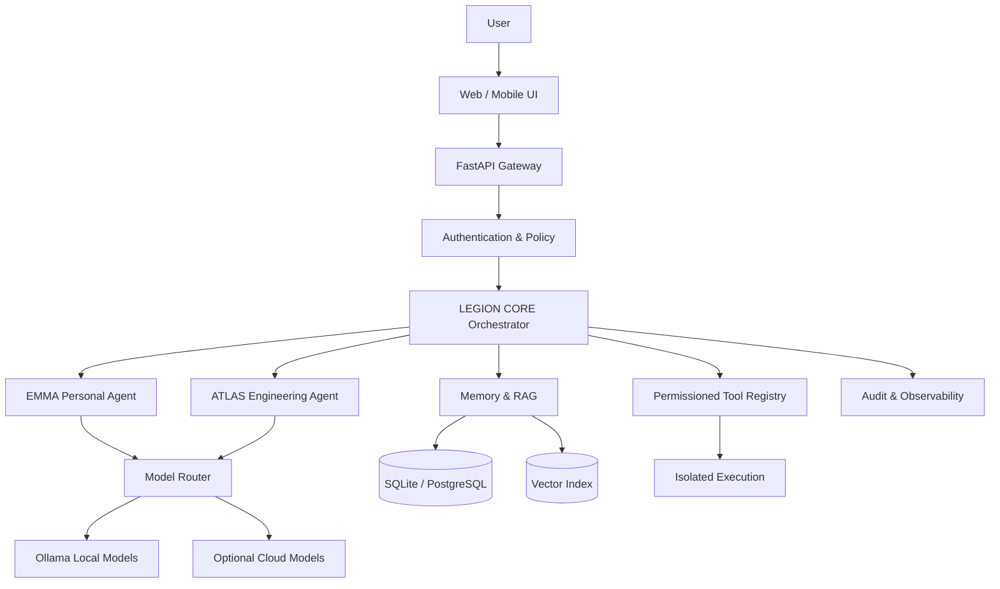

<div align="center">

# LEGION AI — AtlasXEmma

### Dual-Agent Intelligence • Hybrid Local + Cloud • Privacy by Design

**ATLAS × EMMA — Two specialized agents. One coordinated intelligence platform.**

[](#development-status) [](#technology-stack) [](#technology-stack) [](#technology-stack)

**Project:** `Legion-AI-AtlasXEmma`  
**Organization:** Independent LEGION AI project  
**Repository:** [EnzoXpert/Legion-AI-AtlasXEmma](https://github.com/EnzoXpert/Legion-AI-AtlasXEmma) *(proposed; verify after creation)*

</div>

---

## Overview

**LEGION AI — AtlasXEmma** is a proposed modular, multi-agent AI platform combining a personal assistant (**EMMA**) and an engineering assistant (**ATLAS**) through a shared orchestration layer (**LEGION CORE**).

The platform is designed to support local-first AI workflows with optional cloud-model access, configurable tool permissions, persistent memory, retrieval-augmented generation (RAG), and auditable automation.

> **Development status:** This README is a product and implementation blueprint, not a claim that all features are implemented. See [Roadmap](#development-roadmap) for planned delivery phases.

## Core Agents

| Agent | Role | Planned capabilities |
| --- | --- | --- |
| **EMMA** | Personal AI companion | Conversational assistance, task planning, contextual memory, voice interaction, personal knowledge retrieval |
| **ATLAS** | Engineering and operations agent | Coding assistance, repository analysis, test orchestration, DevSecOps guidance, documentation, approved tool execution |
| **LEGION CORE** | Shared control plane | Agent routing, task orchestration, capability-based tool access, policy enforcement, logging, model selection |

EMMA and ATLAS may collaborate on tasks, but each tool action must remain within explicit user-granted permissions and security policy.

## Architecture



### Design Principles

- **Local-first:** Prefer on-device or self-hosted processing when available.
- **Hybrid inference:** Allow cloud models only when configured and permitted.
- **Separation of duties:** Keep agent identity, permissions, memory scopes, and execution contexts distinct.
- **Human control:** Require explicit confirmation for destructive, privileged, or externally consequential actions.
- **Extensibility:** Add agents, tools, model providers, and connectors through versioned interfaces.
- **Traceability:** Maintain structured logs, task IDs, tool invocation records, and test evidence.

## Planned Features

### EMMA

- Personal conversational interface and optional voice mode
- User-controlled long-term memory and contextual retrieval
- Notes, tasks, reminders, and knowledge assistance
- Optional approved integrations with external services
- Privacy controls for memory retention and deletion

### ATLAS

- Repository navigation, code explanation, and change proposals
- Development planning, issue decomposition, and documentation
- Test and build orchestration in isolated environments
- Security-oriented review and defensive diagnostics
- Git workflows with branch protection and approval gates

### LEGION CORE

- Multi-agent task routing and collaboration
- Tool registry with capability-based access control
- Model provider abstraction (local and optional cloud)
- Memory and RAG pipelines
- Background job scheduling with explicit authorization
- Audit logs, metrics, and operational health checks

## Proposed Repository Structure

```text
Legion-AI-AtlasXEmma/
├── apps/
│   ├── api/                 # FastAPI application
│   └── dashboard/           # Web dashboard
├── packages/
│   ├── legion_core/         # Orchestration and policy
│   ├── agents/
│   │   ├── emma/            # Personal assistant
│   │   └── atlas/           # Engineering assistant
│   ├── ai_engine/           # Model adapters and routing
│   ├── memory/              # Storage, embeddings, RAG
│   ├── tools/               # Approved tool integrations
│   └── security/            # Authorization and audit
├── tests/                   # Unit and integration tests
├── docs/                    # Architecture and operations
├── infra/                   # Container and deployment files
├── .github/workflows/       # CI workflows
├── .env.example             # Configuration template
├── pyproject.toml           # Python project configuration
└── README.md
```

This is a **target structure**, not a verified inventory of files currently in the repository.

## Technology Stack

| Layer | Proposed technology |
| --- | --- |
| Backend | Python 3.11+, FastAPI, Pydantic |
| Frontend | React, TypeScript, Tailwind CSS |
| Local inference | Ollama |
| Cloud inference | Optional provider adapters |
| Database | SQLite for local development; PostgreSQL for shared deployment |
| Retrieval | Embeddings + vector search / pgvector |
| Task processing | Async Python workers and optional queue |
| Containers | Docker / Docker Compose |
| Testing | pytest, HTTP integration tests, frontend tests |
| CI/CD | GitHub Actions |
| Observability | Structured logs; optional OpenTelemetry |

## Getting Started

**The installation commands below are a target workflow for the first implementation milestone.** They are not guaranteed to work until the corresponding application files and dependency definitions have been committed.

### Prerequisites

- Git
- Python 3.11 or newer
- Node.js LTS and npm (for the dashboard)
- Ollama (optional for local model inference)
- Docker (optional for containerized deployment)

### Clone

```bash
git clone https://github.com/EnzoXpert/Legion-AI-AtlasXEmma.git
cd Legion-AI-AtlasXEmma
```

### Planned Backend Setup

```bash
python -m venv .venv
source .venv/bin/activate  # Windows: .venv\Scripts\activate
pip install -e '.[dev]'
cp .env.example .env
uvicorn apps.api.main:app --reload
```

### Planned Dashboard Setup

```bash
cd apps/dashboard
npm install
npm run dev
```

### Optional Local Model

```bash
ollama serve
# In a separate terminal, after selecting an available model:
ollama pull <model-name>
```

Never commit `.env`, API keys, credentials, or personal memory databases.

## Configuration (Proposed)

```dotenv
LEGION_ENV=development
LEGION_HOST=127.0.0.1
LEGION_PORT=8000
LEGION_DEFAULT_AGENT=emma
LEGION_MODEL_PROVIDER=ollama
OLLAMA_BASE_URL=http://127.0.0.1:11434
LEGION_CLOUD_ENABLED=false
LEGION_MEMORY_BACKEND=sqlite
LEGION_DATABASE_URL=sqlite:///./legion.db
LEGION_TOOL_APPROVAL_REQUIRED=true
LEGION_AUDIT_ENABLED=true
```

These names are **proposed configuration keys** and must be implemented before use.

## API Contract (Planned)

| Method | Endpoint | Purpose |
| --- | --- | --- |
| `GET` | `/health` | Service readiness |
| `GET` | `/api/v1/agents` | List available agents |
| `POST` | `/api/v1/chat` | Route a conversation to EMMA or ATLAS |
| `POST` | `/api/v1/tasks` | Create an authorized task |
| `GET` | `/api/v1/tasks/{task_id}` | Inspect task state |
| `GET` | `/api/v1/tools` | List permitted tools |
| `GET` | `/api/v1/audit` | Authorized audit-log access |

All endpoints require implementation and tests. Sensitive endpoints must enforce authentication and scoped authorization.

## Security Model

1. **Least privilege:** Tools are denied by default until explicitly enabled.
2. **Human approval:** Confirm file deletion, external writes, deployments, financial actions, and privileged commands.
3. **Execution isolation:** Run untrusted code and tools in constrained containers or sandboxes.
4. **Secret management:** Keep tokens out of source control and logs; use environment injection or a secret manager.
5. **Data boundaries:** Prevent unauthorized memory sharing between agents, users, and cloud providers.
6. **Auditability:** Record who requested an action, the selected agent, permissions, outcome, and relevant timestamps.
7. **Prompt-injection resistance:** Treat retrieved documents, webpages, tool outputs, and repository content as untrusted inputs.

> LEGION AI is intended for authorized administration, defensive security, and legitimate development workflows. It does not grant agents unrestricted access to host systems or third-party services.

## Development Roadmap

| Phase | Milestone | Deliverables | Status |
| --- | --- | --- | --- |
| 01 | Foundation | Monorepo, configuration, FastAPI skeleton, CI, baseline tests | Planned |
| 02 | AtlasXEmma | Agent profiles, chat routing, model adapters, initial UI | Planned |
| 03 | Memory | Persistent storage, retrieval, memory controls | Planned |
| 04 | Tools & Security | Tool registry, approvals, sandbox, audit | Planned |
| 05 | Collaboration | Multi-agent task handoff, workflow state, scheduling | Planned |
| 06 | Hybrid Deployment | Ollama integration, optional cloud provider, containers | Planned |
| 07 | Beta | Integration tests, documentation, performance and security review | Planned |

### Sprint 01 Acceptance Criteria

- [ ] Create a feature branch without changing `main`
- [ ] Commit a bootable FastAPI application
- [ ] Define EMMA and ATLAS as distinct agent profiles
- [ ] Implement a validated agent-routing API
- [ ] Add a local mock model adapter for deterministic tests
- [ ] Add unit tests and API integration tests
- [ ] Enforce tool execution deny-by-default
- [ ] Add a CI workflow for linting and tests
- [ ] Open a draft pull request; do not merge without review

## Contributing

Development changes should be made on feature branches and submitted as pull requests. Include a concise summary, test evidence, and any security implications. Avoid committing credentials, personal data, or generated secrets.

## License

**To be determined.** No open-source license is granted by this README alone. Add a `LICENSE` file once the project owner selects licensing terms.

## Disclaimer

This repository describes an evolving software project. Features, security guarantees, integrations, and deployment capabilities must be validated against actual code and tests before being represented as production-ready.

---

<div align="center">

**LEGION AI — AtlasXEmma**  
*Two agents. One intelligence system. Built with control, security, and extensibility in mind.*

</div>
